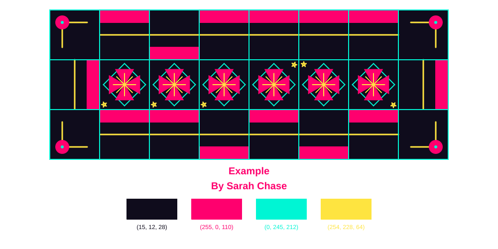

# [Project Title]

**Created by:** [Student 1], [Student 2], [Student 3], [Student 4]  
**Course:** Creative Coding, Pratt Institute  
**Semester:** Fall 2026

## About the Project

[Write a short description (approximately 100–150 words) of your project. What was the idea behind your poster generator? What visual qualities or design ideas inspired it? How does the program combine everyone's individual tile designs into a unified composition?]

## The Design

Our poster generator creates a grid of geometric tiles using a collection of custom-designed functions. Each tile can be rotated, colored, and positioned according to its location in the grid. Users can choose the dimensions of the poster and select from a collection of color palettes, or generate a random palette.

## Meet the Designers

- **[Student 1]:** [Brief description of their tile designs or contribution.]
- **[Student 2]:** [Brief description of their tile designs or contribution.]
- **[Student 3]:** [Brief description of their tile designs or contribution.]
- **[Student 4]:** [Brief description of their tile designs or contribution.]

## Try the Poster Generator

Click below to open the notebook in Google Colab and generate your own poster!

### How to Use

1. Open the notebook in Google Colab.
2. Run the setup cells to download the project code and install the required libraries.
3. Choose a title, grid dimensions, and color palette.
4. Run the generator to create your own poster!

## Files

- `project.py` – Main poster-generation program.
- `TileFunctions.py` – Collection of custom tile-drawing functions.
- `PaletteOptions.py` – Available color palettes.
- `requirements.txt` – Required Python libraries.
- `poster.png` – Final poster image.
- `poster.svg` – Scalable vector version of the poster.
- `[notebook].ipynb` – Notebook for running the generator.

## Individual Reflections

**[Student 1]**

[What did you learn about programming or design through this project? How did your tile design change when it became part of a larger system?]

**[Student 2]**

[What did you learn about programming or design through this project? How did your tile design change when it became part of a larger system?]

**[Student 3]**

[What did you learn about programming or design through this project? How did your tile design change when it became part of a larger system?]

**[Student 4]**

[What did you learn about programming or design through this project? How did your tile design change when it became part of a larger system?]
